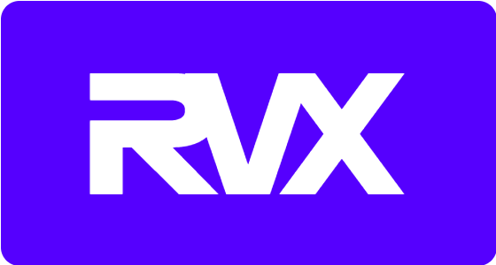
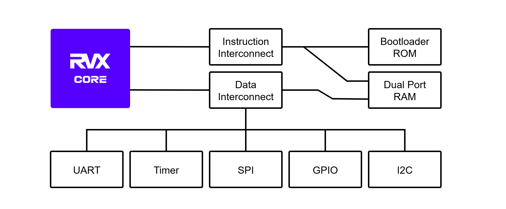

<strong>Open-Source RISC-V Microcontroller IP</strong>

### What Is RVX?

RVX is a RISC-V microcontroller IP core designed to power a wide range of applications across fields such as IoT, robotics, and industrial automation.

Written in Verilog and designed for integration into FPGA and ASIC designs, RVX combines a flexible and configurable hardware architecture with firmware and development tools to simplify and accelerate the development of embedded applications.

### Features

RVX combines a RISC-V 32-bit processor, on-chip memory, and commonly used peripherals into a single hardware IP, providing a foundation for embedded systems and custom SoCs. It supports bare-metal applications and FreeRTOS, and includes a [software development kit][1] (SDK) to simplify firmware development.

- **Base ISA** — RISC-V RV32I (32-bit integer ISA).
- **ISA Extensions** — Zicsr and optional Zmmul.
- **Memory** — Configurable tightly-coupled RAM and bootloader ROM.
- **Peripherals** — UART, SPI, I2C, GPIO, and timer controllers.
- **Software** — Runs bare-metal and FreeRTOS applications.
- **SDK** — Peripheral drivers, startup code, linker scripts, and CMake integration.

### Architecture

The diagram below illustrates the main hardware components of RVX and their interconnections.

### Getting Started

The quickest way to get started with RVX is to implement it on an FPGA. RVX provides Vivado projects for the Arty A7 and Cmod A7 boards, which can also serve as a starting point for porting RVX to other FPGA platforms.

To get RVX up and running on one of these boards, follow the steps below:

1. **Open Vivado** and select **Tools > Run Tcl Script**.
2. **Select the Tcl script** for your FPGA board:
   - Arty A7-35T: [boards/arty_a7/create_project_arty_a7_35t.tcl](boards/arty_a7/create_project_arty_a7_35t.tcl)
   - Arty A7-100T: [boards/arty_a7/create_project_arty_a7_100t.tcl](boards/arty_a7/create_project_arty_a7_100t.tcl)
   - Cmod A7: [boards/cmod_a7/create_project_cmod_a7.tcl](boards/cmod_a7/create_project_cmod_a7.tcl)
3. **Generate the bitstream** by clicking **Generate Bitstream** in Vivado.
4. **Program the FPGA** by connecting your board to your computer and using Vivado's **Hardware Manager** to load the generated bitstream.
5. **Run the example** by opening a serial terminal (such as PuTTY or PySerial) connected to your board's serial port, then pressing **BTN0**.

The provided projects are configured to run the [Hello World](examples/hello_world) example. After pressing BTN0, you should see the **Hello World** message in your serial terminal.

### License

RVX is free and open source, distributed under the [MIT License][2].

[1]: https://github.com/rafaelcalcada/rvx-sdk
[2]: LICENSE