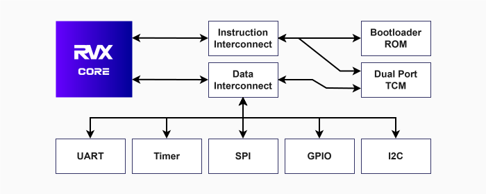

# RVX Hardware Docs

## Introduction

RVX is a microcontroller IP core developed in Verilog that implements the RV32I instruction set of RISC-V and optionnaly the Zmmul extension. It is designed for easy, seamless integration into embedded systems and FPGA designs, facilitating the rapid development of innovative RISC-V applications.

RVX can run real-time operating systems such as FreeRTOS, as well as bare-metal embedded software. Its design includes components such as memory, timers, and interfaces for UART, GPIO, and SPI communication, enabling RVX to integrate with a variety of sensors and actuators commonly used in embedded applications.

For information on how to develop a new application with RVX, see the [User Guide](userguide.md).

RVX implements the following features of the RISC-V specifications:

- the RV32I Base Integer Instruction Set, `v2.1`
- the Zicsr Extension for Control and Status Register (CSR) Instructions, `v2.0`
- the Machine-Level ISA, `v1.13`
- Optionnal Zmmul extension for integer multiplication, `v0.1`

## Architecture

A top-level view of RVX architecture is presented in the diagram below.

 

<figure markdown="span">
{ width=70% }
<figcaption><strong>Figure 1.</strong> RVX Architecture</figcaption>
</figure>

## Source Files

The source files of RVX are saved in the `rtl/` folder of its [repository](https://github.com/rafaelcalcada/rvx).

## Configuration

The table below lists the configuration parameters of RVX Top Module, `rvx.v`:

| Parameter name and description                                                            | Value type          | Default value    |
| ----------------------------------------------------------------------------------------- | ------------------- | ---------------- |
| **RAM_SIZE_IN_BYTES** Size of RAM in bytes.                                          | Integer             | `8192`           |
| **BOOT_IMAGE_PATH** Path to the boot image loaded into RAM.                           | String              | `(empty string)` |
| **GPIO_PIN_COUNT** Number of general-purpose I/O pins.                               | Integer             | `1`              |
| **ENABLE_ZMMUL** Enable the Zmmul extension.                                          | Boolean             | `0`              |

## I/O Signals

The input/output signals of RVX Top Module, `rvx.v`, are listed in the table below:

| Pin name and description                        | Direction | Size                  |
| ----------------------------------------------- | --------- | --------------------- |
| **clock** Clock input.                      | Input     | 1 bit                 |
| **reset_n** Reset pin (active-low).         | Input     | 1 bit                 |
| **uart_rx** UART receiver pin.              | Input     | 1 bit                 |
| **uart_tx** UART transmitter pin.           | Output    | 1 bit                 |
| **gpio_input** GPIO input signals.          | Input     | `GPIO_PIN_COUNT`      |
| **gpio_output_enable** GPIO output enable.  | Output    | `GPIO_PIN_COUNT`      |
| **gpio_output** GPIO output signals.        | Output    | `GPIO_PIN_COUNT`      |
| **spi_sclk** SPI clock.                     | Output    | 1 bit                 |
| **spi_mosi** SPI Manager Out, Subordinate In. | Output  | 1 bit                 |
| **spi_miso** SPI Manager In, Subordinate Out. | Input   | 1 bit                 |
| **spi_cs** SPI chip select.                 | Output    | 1 bit                 |
| **i2c_sda_input** I2C SDA input.            | Input     | 1 bit                 |
| **i2c_sda_output** I2C SDA output.          | Output    | 1 bit                 |
| **i2c_scl_input** I2C SCL input.            | Input     | 1 bit                 |
| **i2c_scl_output** I2C SCL output.          | Output    | 1 bit                 |

## Memory Map

The devices in RVX are mapped to memory addresses as detailed below:

| Start address | Final address       | Range size (Bytes) | Device                     |
| ------------- | ------------------- | ------------------ | -------------------------- |
| `0x00000000`  | `0x(MEMORY_SIZE-1)` | `MEMORY_SIZE`      | RAM                        |
| `0x80000000`  | `0x8000000f`        | 16                 | UART Controller            |
| `0x80010000`  | `0x8001001f`        | 32                 | Timer                      |
| `0x80020000`  | `0x8002001f`        | 32                 | GPIO Controller            |
| `0x80030000`  | `0x8003001f`        | 32                 | SPI Controller             |

 
 